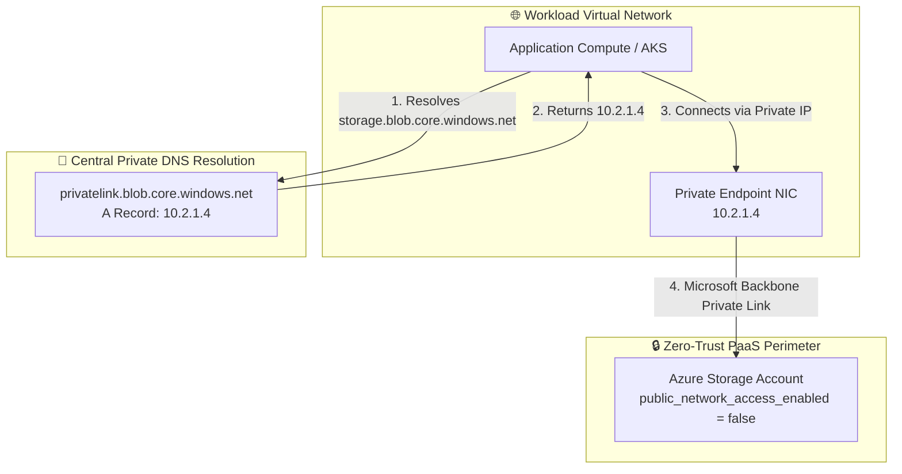

# Azure Private Networking Landing Zone (Terraform)

[](https://github.com/sanjiivsingh/azure-landing-zone-private-networking/actions)
[](https://opensource.org/licenses/MIT)

An enterprise-grade, modular Terraform landing zone implementing **Azure Private Endpoints**, **Private DNS Zones**, and **centralized private name resolution** adhering to the **Microsoft Cloud Adoption Framework (CAF)**.

---

## 🏛️ Architecture Overview



---

## 🌟 Key Features
- **Centralized Private DNS Zones:** Covers core Azure services: Storage Blob, Key Vault, and Azure SQL.
- **Automated VNet Linking:** Seamlessly connects Private DNS zones across multi-subscription virtual networks.
- **Reusable Private Endpoint Pattern:** Universal module for attaching Private Endpoints to any PaaS resource with automated DNS group registration.
- **Zero Public Exposure:** Disables public IP interfaces across PaaS resources, routing all data via the Microsoft global backbone.
- **Automated CI/CD Validation:** Pre-configured GitHub Actions and Azure DevOps pipeline workflows.

---

## 📁 Repository Structure
```text
azure-landing-zone-private-networking/
├── README.md
├── LICENSE
├── CONTRIBUTING.md
├── SECURITY.md
├── CHANGELOG.md
├── docs/                      # Architectural & operational documentation
├── diagrams/                  # Mermaid diagram source definitions
├── modules/
│   ├── private_dns/           # Private DNS zones and VNet links
│   └── private_endpoints/     # Reusable private endpoint module
└── environments/
    └── dev/                   # Dev environment deployment configuration
```

---

## 🚀 Quick Start Deployment

### Prerequisites
- Terraform `>= 1.9.0`
- Azure CLI with `Network Contributor` role.

### Deploying the Dev Environment
```bash
cd environments/dev

# Copy example configurations
cp terraform.tfvars.example terraform.tfvars

# Initialize Terraform
terraform init

# Validate configuration
terraform validate

# Review plan
terraform plan

# Apply infrastructure
terraform apply
```

---

## 🛡️ DevSecOps & Security
- **CI/CD Quality Gates:** Automated execution of `terraform fmt`, `tflint`, and `terraform validate`.
- **Checkov SAST:** Continuous static security scanning against CIS Azure benchmarks.
- **Azure DevOps Pipeline:** Pre-configured YAML pipeline template under `pipelines/azure-devops/validation.yml`.

---

## 📄 License
This project is open-source under the [MIT License](LICENSE).
